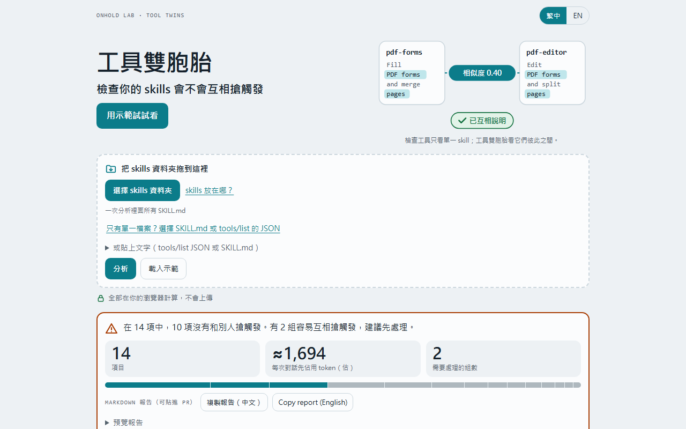
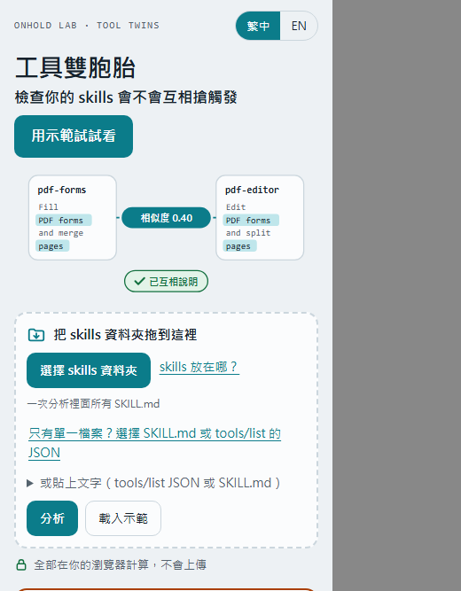

# 工具雙胞胎 Tool Twins

檢查你的 skills 會不會互相搶觸發。

**線上使用：https://onholdlab.github.io/tool-twins/**

你裝了很多 Claude skills 或 MCP 工具時，有些名稱或描述太像，模型可能選錯。工具雙胞胎找出這些「雙胞胎」：
- 指出哪幾組最需要先處理，並給一句可以補進描述的排除說明。
- 估算每個項目在每次對話開始時先佔用多少 token。

這是啟發式檢查，可能誤報，也可能漏報；分數和標籤只是提示，不是定論。

## 怎麼用

1. 打開 https://onholdlab.github.io/tool-twins/ ，或下載這個倉庫的 `index.html` 直接用瀏覽器開啟（單一檔案，不需要安裝）。
2. 按「選擇 skills 資料夾」，選你的 skills 資料夾，例如 Windows 的 `C:\Users\你的名字\.claude\skills`，或 Mac／Linux 的 `~/.claude/skills`。
   - 也可以只選單一個 SKILL.md、MCP 的 tools/list JSON，或直接貼上文字。
3. 按「分析」，看結論卡和三條道：需要先處理／可以更好／已經做對。

想先看看效果，按「用示範試試看」。手機上請用示範或貼上文字。

## 怎麼判定

skill 只比較描述。兩個 skill 列為「需要先處理」的條件：描述相似度 ≥ 0.50，或共用觸發詞（兩個詞，或一個引號短語）且相似度 ≥ 0.30；而且兩邊都沒有指向對方的排除說明或轉交句（例如「For …, use 另一個 skill」）。只共用觸發詞、相似度低於 0.30 的組合放在摺疊的「弱訊號」區塊，不計入結論與可節省的 token。

## 不會上傳

所有計算都在你的瀏覽器裡完成：頁面不送出任何網路請求，不載入外部字型或函式庫，你的檔案不會離開你的電腦。

## 測試

這個倉庫只放網站檔案。發佈前，頁面已在無頭瀏覽器中通過以下測試：判定回歸、首屏與 375px 版面、亮暗色、真實鍵盤操作，以及「沒有任何外部請求」。測試腳本不在這個倉庫。

## 回報誤報

工具把不像的組合判成雙胞胎，或漏掉真的會搶觸發的組合？請用[誤報／漏報表單](https://github.com/onholdlab/tool-twins/issues/new?template=wrong-result.yml)回報：
- 填哪兩個項目、工具怎麼判斷、你認為哪裡不對。
- 可以附上兩邊的描述，貼之前請先去除敏感內容。

其他建議請用[建議與其他](https://github.com/onholdlab/tool-twins/issues/new?template=feedback.yml)。

## 授權

- 程式碼採 [Apache License 2.0](LICENSE)，Copyright 2026 onholdlab。
- 內建示範資料的第三方來源與授權列在 [NOTICE](NOTICE)。
- 「onholdlab」「稍等工作室」「Tool Twins」「工具雙胞胎」等名稱與標誌不在授權範圍內。Apache 2.0 第 6 條本來就不授予商標權。

---

## English

**Tool Twins** checks whether your Claude skills and MCP tools compete for the same requests. It flags pairs whose names or descriptions are close enough for a model to pick the wrong one. For each pair it suggests a "not for … use … instead" line, and it estimates the tokens each item costs in every conversation. It is a heuristic and can raise false alarms or miss real twins.

- **Use:** open https://onholdlab.github.io/tool-twins/ (or download `index.html`), then choose your skills folder (`~/.claude/skills`), pick a file, or paste text. Or press "Try the demo".
- **Private:** everything runs in your browser. The page makes no network requests and nothing is uploaded.
- **How pairs are flagged:** skills are compared on their descriptions. A pair is listed under "Fix first" at similarity ≥ 0.50, or with shared trigger words (two words or one quoted phrase) at similarity ≥ 0.30, when neither side points at the other with an exclusion or a routing clause ("For …, use other-skill"). Trigger-only pairs under 0.30 sit in a collapsed "weak signal" block and are not counted.
- **Wrong result?** Report a false alarm or a missed twin with the [wrong-result form](https://github.com/onholdlab/tool-twins/issues/new?template=wrong-result.yml) (remove sensitive content from any description you paste). Other ideas: [suggestions](https://github.com/onholdlab/tool-twins/issues/new?template=feedback.yml).
- **License:** Apache License 2.0 (see [LICENSE](LICENSE)). Third-party demo data is credited in [NOTICE](NOTICE). The names and logos are not covered by the license.
